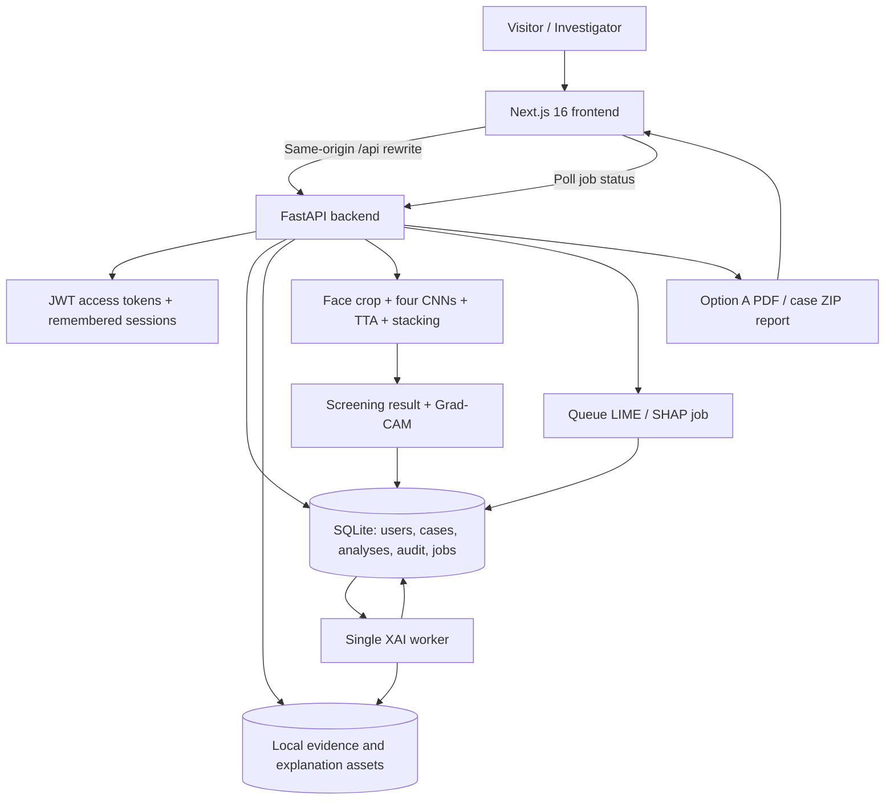

<p align="center">
  
</p>

<h1 align="center">NeuralEdge AI</h1>

<p align="center">
  <strong>Explainable Deepfake Image Screening for Digital Forensic Investigations</strong><br />
  Final Year Design Project (FYDP) · Repository release <strong>v2.0.0</strong>
</p>

<p align="center">
  <strong>Researched &amp; Developed by</strong><br />
  <strong>Masum Al Mahamud &amp; Shinthiya Islam Ayshi</strong>
</p>

---

> [!IMPORTANT]
> **NeuralEdge AI is an AI-assisted screening and forensic triage system, not an image-authenticity certificate.** A **Fake** prediction does not prove manipulation; a **Real** prediction does not authenticate an image. Model scores are not guaranteed calibrated probabilities, and visual explanations are not verified edit-location maps. Results require human review and independent evidence.

## Overview

**NeuralEdge AI** combines a four-backbone deep-learning ensemble with explainable AI and an investigator-oriented web application. Investigators can submit image evidence, obtain a Real/Fake **screening** result, inspect model explanations, organize analyses into cases, and export a structured PDF forensic dossier.

The application has two interfaces: a public landing page with an optional guest-detection demonstration, and an authenticated investigator workspace. The deployed prediction pipeline is based on the project's **final v3 research/deployment bundle**; **v2.0.0** refers to the **website/repository release**, not a different model-generation claim.

### What's included in v2.0.0

| Area | Capabilities |
| --- | --- |
| Public site | Responsive landing page, technology overview, researcher credits, unified branded header, optional guest image screening |
| Investigator accounts | Registration, login, remembered sessions, profile editing, password changes, session management and logout |
| Image analysis | Evidence upload, SHA-256 identity, four-CNN ensemble prediction, class scores and Grad-CAM |
| Explainability | On-demand LIME and SHAP, class-aware image interpretation, optional facial-region localization |
| Background XAI | Persistent SQLite-backed jobs, polling, deduplication, retries, queued-job cancellation and refresh recovery |
| Investigation management | Cases, status changes, linked analyses, evidence previews, search/filtering and controlled deletion |
| Reports | Downloadable **Option A Forensic Dossier** PDF per analysis, plus per-case PDF ZIP export |
| Analytics | Version-matched model performance, comparison metrics and documented research limitations |
| Branding | NeuralEdge shield/face logo in the website, browser tab and PDF headers |

## Contents

- [Research model and evaluation](#research-model-and-evaluation)
- [How the system works](#how-the-system-works)
- [Technology stack](#technology-stack)
- [Project structure](#project-structure)
- [Getting started](#getting-started)
- [Configuration](#configuration)
- [API overview](#api-overview)
- [Explainability and reporting](#explainability-and-reporting)
- [Security and evidence handling](#security-and-evidence-handling)
- [Testing](#testing)
- [Cloud deployment considerations](#cloud-deployment-considerations)
- [Limitations and reproducibility](#limitations-and-reproducibility)
- [Release checklist](#release-checklist)
- [Credits](#credits)

## Research model and evaluation

### Deployed inference architecture

The final v3 deployment bundle specifies four CNN backbones:

1. **MobileNetV2**
2. **ResNet50V2**
3. **Xception**
4. **EfficientNetB0**

For each backbone, the system averages the **Fake-category scores** from the original face crop and its horizontal flip (**test-time augmentation**, or TTA). A serialized **logistic-regression stacking meta-learner** combines the four scores in the fixed model order above. The deployed decision threshold is **0.50**; the positive class is **Fake (1)** and the negative class is **Real (0)**.

**Preprocessing contract:** decode a supported image to RGB; detect faces with **MTCNN**; select the largest valid face; extract a square crop with approximately 25% margin on each side; resize to **224 × 224** using OpenCV; and pass RGB pixels in the **0–255** range to the saved models. A centered square crop is used if a suitable face is not detected. The pipeline does not silently apply an extra evaluation equalizer.

### Final v3 held-out research results

These figures come from the **final v3 `deployment_config.json`** bundled with the corresponding model exports, **not** from older notebooks or from live website uploads.

| Model / method | Test accuracy | Fake recall | Fake F1 | ROC-AUC |
| --- | ---: | ---: | ---: | ---: |
| MobileNetV2 | 90.32% | 96.05% | 90.68% | 0.9642 |
| ResNet50V2 | 87.10% | 89.47% | 87.18% | 0.9524 |
| Xception | 82.58% | 88.16% | 83.23% | 0.9184 |
| EfficientNetB0 | 87.10% | 93.42% | 87.65% | 0.9582 |
| Soft-vote TTA (research comparison) | 90.97% | 96.05% | 91.25% | 0.9747 |
| **Four-model stacking + TTA (deployed)** | **91.61%** | **92.11%** | **91.50%** | **0.9745** |

**Test set:** 155 images (**79 Real / 76 Fake**). The deployed stacked model's confusion matrix was **TN 72, FP 7, FN 6, TP 70**, with **91.62% balanced accuracy**. All figures correspond to the saved **0.50 threshold**.

> [!NOTE]
> These are **internal held-out research metrics**, not a validated claim of performance on arbitrary images, social-media sources, unseen people or future generators. Dataset composition, preprocessing parity, domain shift and image-quality shortcuts may affect real-world performance. The live **Model Analytics** page reads metrics from the active deployment manifest instead of hardcoding older study results.

## How the system works



A normal authenticated analysis follows this sequence:

1. Log in and upload a **JPEG or PNG** image as evidence.
2. The API stores the original bytes and their **SHA-256** hash.
3. Run analysis on the evidence ID; the model saves the prediction and initial **Grad-CAM** assets.
4. Optionally request **LIME** or **SHAP**. The API returns a job record immediately and the website polls for status, rather than maintaining a long HTTP request.
5. Review the result, attach the analysis to one or more investigation cases, and export the available explanations as a PDF.

The public guest flow (`/detect`) is separate: it offers a quick screening result without saving investigator evidence, explanations or cases. Guest screening is **disabled unless explicitly enabled** in backend configuration.

## Technology stack

| Layer | Technologies |
| --- | --- |
| Frontend | Next.js **16**, React **19**, TypeScript, Tailwind CSS **4**, Lucide icons |
| API | Python, FastAPI, Uvicorn, Pydantic |
| Deep learning | TensorFlow / Keras; MobileNetV2, ResNet50V2, Xception, EfficientNetB0 |
| Ensemble | scikit-learn logistic-regression stacking, joblib, TTA |
| Image processing | OpenCV, Pillow, MTCNN |
| Explainability | Grad-CAM, LIME, SHAP, optional MediaPipe Face Landmarker |
| Persistence | SQLite, local filesystem, SHA-256 integrity records |
| Authentication | Argon2 password hashing, short-lived JWTs, HttpOnly remembered-session cookies |
| Reports | ReportLab; A4 Option A Forensic Dossier PDF |
| Async work | SQLite-backed job queue and a single embedded or external worker |

## Project structure

```text
fydp_web/
├── README.md                          # This repository overview
├── .gitignore
├── frontend/
│   ├── next.config.ts                 # /api reverse-proxy rewrite
│   ├── package.json
│   ├── public/branding/                # Logo assets
│   └── src/
│       ├── app/
│       │   ├── page.tsx               # Public landing page
│       │   ├── detect/                # Guest screening
│       │   ├── login/ and register/
│       │   └── (protected)/           # Dashboard, Analyze, Cases,
│       │                              # Reports, Model Analytics, Settings
│       ├── components/                # Navigation, XAI, case management, UI
│       └── services/api.ts            # Backend API client
└── backend/
    ├── app/
    │   ├── main.py                    # FastAPI routes and auth
    │   ├── config.py, database.py, schemas.py
    │   ├── inference_v2.py           # Final-v3 four-CNN runtime adapter
    │   ├── explainability_service.py
    │   ├── face_region_interpreter.py
    │   ├── narrative_service.py
    │   ├── report_service.py          # Option A PDF
    │   ├── xai_jobs.py                # Persistent XAI queue
    │   └── xai_worker_cli.py          # Optional dedicated worker
    ├── assets/neuraledge_report_logo.png
    ├── tools/verify_final_v3_artifacts.py
    ├── tests/
    ├── requirements*.txt
    ├── artifacts_v2/                 # PRIVATE/IGNORED model bundle
    └── storage/                      # PRIVATE/IGNORED DB and evidence
```

**Private files are intentionally not distributed via GitHub:** model weights, stacking learner, original uploads, generated explanation assets, SQLite databases, local configuration secrets and the optional MediaPipe task asset.

## Getting started

The documented path below targets the project's **Windows PowerShell / VS Code** development workflow. Use a trusted copy of the final-v3 model bundle; the GitHub source checkout **alone cannot run real inference** without the weights and learner.

### 1. Prerequisites

- Git, a supported **Node.js 20+** installation and npm.
- **Python 3.12** and sufficient local RAM for four TensorFlow models and optional XAI processing.
- The **trusted final v3 deployment bundle** (four `.keras` models, `stacking_meta_learner.joblib`, `deployment_config.json` and its associated metadata/checksums).
- Optional **MediaPipe `face_landmarker.task`** for named facial-region interpretation.

### 2. Set up the backend

From the repository root:

```powershell
cd backend
py -3.12 -m venv .venv-v2
.\.venv-v2\Scripts\Activate.ps1
python -m pip install --upgrade pip
python -m pip install -r requirements-dev.txt -r requirements-ml.txt
```

The current requirements files cover the web application and base TensorFlow dependencies but **do not fully declare every final-v3 XAI/inference library**. For a fresh environment, install the additionally imported libraries using versions compatible with the saved deployment environment:

```powershell
python -m pip install "scikit-learn==1.6.1" joblib mtcnn lime shap mediapipe opencv-python-headless
python -m pip check
```

The exported learner was created in a scikit-learn **1.6.1** environment; verify compatible loading rather than silently accepting a different serialization version. The bundle identifies TensorFlow **2.21.0**, whereas `requirements-ml.txt` currently pins **2.20.0**. Loading and numerical parity should be checked on the actual machine before declaring a clean environment reproducible. Existing working `.venv-v2` environments need not be recreated just for this README.

Create a backend configuration:

```powershell
Copy-Item .env.example .env
python -c "import secrets; print(secrets.token_urlsafe(48))"
```

Paste the generated secret into `JWT_SECRET` in `backend/.env`, then configure the final-v3 model manifest as shown in [Configuration](#configuration).

### 3. Install the model bundle locally

Place the trusted files in:

```text
backend/artifacts_v2/deployment_bundle/
├── deployment_config.json
├── MobileNetV2.keras
├── ResNet50V2.keras
├── Xception.keras
├── EfficientNetB0.keras
├── stacking_meta_learner.joblib
├── sha256_checksums.json
├── xai_report_contract.json
├── threshold_selection_protocol.json
└── environment_versions.json
```

The optional MediaPipe task can be placed at `backend/assets/face_landmarker.task`; configure its path if used. **Never load model archives or joblib files from an untrusted source**—serialized model artifacts may execute code when loaded.

Validate the bundle:

```powershell
python tools/verify_final_v3_artifacts.py artifacts_v2/deployment_bundle/deployment_config.json
```

To additionally run a real-image smoke test, append `--smoke-image "C:\path\to\your\test-image.jpg"`. The image must be one you are authorized to analyze.

### 4. Start the API

From `backend/`, with `.venv-v2` activated:

```powershell
python -m uvicorn app.main:create_app --factory --reload --host 127.0.0.1 --port 8000
```

Check:

- API health: **http://127.0.0.1:8000/api/health**
- Interactive API documentation: **http://127.0.0.1:8000/docs**

The health response includes an `inference_ready` indicator. It must be **true** for real detection; a functioning web server alone does not mean model weights loaded successfully.

### 5. Start the frontend

Open a **second PowerShell terminal**:

```powershell
cd frontend
npm ci
npm run dev
```

Open **http://localhost:3000**. The frontend uses a **same-origin `/api` rewrite** configured in `frontend/next.config.ts`; by default it forwards API requests to `http://127.0.0.1:8000`.

To point at another backend, create `frontend/.env.local` with:

```dotenv
BACKEND_URL=http://127.0.0.1:8000
```

Restart Next.js after changing this setting. Never place backend secrets in `NEXT_PUBLIC_*` variables.

## Configuration

A representative **local-only** `backend/.env` setup is:

```dotenv
JWT_SECRET=REPLACE_WITH_YOUR_OWN_RANDOM_SECRET_OF_32_OR_MORE_CHARACTERS
FRONTEND_ORIGINS=http://localhost:3000,http://127.0.0.1:3000
DATA_DIR=storage
MODEL_MANIFEST=artifacts_v2/deployment_bundle/deployment_config.json
MAX_UPLOAD_BYTES=10485760
REMEMBERED_SESSION_DAYS=7
COOKIE_SECURE=false
GUEST_DETECTION_ENABLED=false
XAI_WORKER_MODE=embedded
# Optional when the asset is installed; resolve relative to backend working directory:
# FACE_LANDMARKER_TASK=assets/face_landmarker.task
```

| Variable | Purpose / default |
| --- | --- |
| `JWT_SECRET` | **Required** random signing key, at least 32 characters |
| `FRONTEND_ORIGINS` | Allowed browser origins for CORS and session-origin checks |
| `MODEL_MANIFEST` | Path **under `backend/`** to the active deployment JSON; default still points at an older `artifacts/manifest.json` |
| `DATA_DIR` | Local database and evidence directory; default `storage` |
| `MAX_UPLOAD_BYTES` | Authenticated evidence-upload limit; current default **10 MiB**; set `5242880` for 5 MiB |
| `REMEMBERED_SESSION_DAYS` | Remembered-session lifetime, default **7 days**; allowed range 1–30 |
| `COOKIE_SECURE` | `false` for local HTTP; use `true` behind correctly configured production HTTPS |
| `GUEST_DETECTION_ENABLED` | Enables the **optional** unauthenticated demo; default `false` |
| `XAI_WORKER_MODE` | `embedded` by default; `external` when running a separate worker on a single shared host |
| `FACE_LANDMARKER_TASK` | Optional path to the local MediaPipe task file |

**Guest uploads:** The guest endpoint has a separate **10 MiB** hardcoded file limit, JPEG/PNG-only validation, an **8-megapixel** pixel-count limit and an in-process limit of **three requests per IP per hour**. Changing `MAX_UPLOAD_BYTES` does **not** currently change that guest limit. These basic controls are not sufficient protection for an open public deployment.

## API overview

All endpoints below are under `/api`. Unless explicitly public, they require a valid investigator Bearer access token. The website manages access tokens in memory and renews them using a limited, HttpOnly remembered-session cookie.

| Resource | Method and route | Use |
| --- | --- | --- |
| Health | `GET /api/health` | Backend/inference readiness (**public**) |
| Authentication | `POST /api/auth/register`, `POST /api/auth/login` | Create account / sign in (**public**) |
| Sessions | `POST /api/auth/refresh`, `POST /api/auth/logout` | Restore or end remembered login |
| Account | `GET /api/auth/me`, `PATCH /api/auth/profile`, `POST /api/auth/password` | Account details, name and password changes |
| Session security | `GET /api/auth/sessions`, `POST /api/auth/sessions/revoke-others`, `POST /api/auth/sessions/revoke-all` | Review/revoke login sessions |
| Evidence | `POST /api/evidence`, `GET /api/evidence` | Upload and list owned evidence |
| Evidence images | `GET /api/evidence/{id}/image`, `/thumbnail` | Authenticated original/thumbnail access |
| Analysis | `POST /api/analyze`, `GET /api/analyses`, `GET /api/analyses/{id}` | Run and retrieve screening analyses |
| XAI jobs | `POST /api/analyses/{id}/explain/{method}` | Queue LIME or SHAP; returns **202 Accepted** |
| XAI status | `GET /api/analyses/{id}/explain/{method}/status` | Poll job status |
| XAI cancel | `DELETE /api/analyses/{id}/explain/{method}/job` | Cancel a **queued**, not running, job |
| XAI assets | `GET /api/analyses/{id}/{asset}` | Authorized image/explanation access |
| Cases | `GET/POST /api/cases`, `GET/PATCH/DELETE /api/cases/{id}` and related routes | Case ownership, status, linking and deletion |
| PDF | `GET /api/report/{analysis_id}` | Generate/download saved-analysis PDF |
| Case export | `GET /api/cases/{case_id}/reports.zip` | Export up to **20** case PDFs in a ZIP |
| Model metadata | `GET /api/model-info`, `GET /api/model-research` | Active model and manifest-matched research information |
| Guest demo | `POST /api/quick-detect` | Optional public image screening; no saved case |

Explore exact request/response schemas and remaining management endpoints at **`/docs`**.

## Explainability and reporting

| Method | Purpose | Important interpretation rule |
| --- | --- | --- |
| **Grad-CAM** | Averages class-specific spatial activation maps from the **four CNNs** on the original face crop | **Not** a direct gradient explanation of the final stacking/TTA score |
| **LIME** | Locally perturbs image segments to approximate the **full stacked classifier** for the selected Real/Fake category | Contributions depend on segmentation and sampling; highlighted regions are **not verified edits** |
| **SHAP** | Explains the selected stacking output relative to a blurred-image reference | Signed contributions are relative to the reference, **not manipulation probabilities** |
| **Face-region interpretation** | Uses approximate MediaPipe landmarks to help readers locate highlighted areas | Availability depends on the optional task asset and successful face localization |

**Asynchronous LIME/SHAP:** Explanation requests are stored in `xai_jobs` in SQLite and processed by **one worker**. The UI polls roughly every three seconds; statuses include `queued`, `running`, `completed`, `failed` and `cancelled`. Duplicate clicks for the same analysis/method reuse an active job. A failed/interrupted job can be retried, while only **queued** work can be cancelled. Queue limits are **2 active jobs per investigator** and **20 active jobs system-wide**. Progress percentages represent approximate stages, not precise time remaining.

**Reports:** Each PDF is generated **from saved results**, using the approved **Option A Forensic Dossier** with the project logo, evidence identifiers, selected-category scoring, explanations available at export time and technical caveats. Grad-CAM is present in a normal completed analysis; LIME/SHAP appear **only after they have been generated and saved**. A basic PDF remains available before optional explanations finish. Case exports bundle PDFs into a ZIP; files are not automatically publicly exposed.

## Security and evidence handling

The current implementation includes these safeguards:

- **Argon2 password hashing**; registration and password changes require at least **8 characters**.
- **30-minute JWT access tokens** and **up to 7-day remembered sessions**, backed by a database and an **HttpOnly, SameSite=Lax** cookie. Logout and session revocation invalidate associated access tokens.
- **Owner-scoped** evidence, cases, analyses, images, jobs, PDFs and report ZIPs.
- Original evidence **SHA-256** recording and integrity checks before sensitive operations.
- Account/session audit events and selected investigation events.
- Backend-controlled model artifact paths and checksums in the trusted deployment bundle.
- Deliberately ignored `.env`, local databases, investigator evidence, model weights and other private files.

**Deletion semantics:** Deleting an analysis removes its analysis record and generated explanation assets, but **retains the original uploaded evidence** for provenance. Case deletion has explicit confirmation and checks for analyses shared with other cases. A running/queued XAI job blocks destructive deletion. Filesystem backups and external copies are outside the deletion API's control.

**Not yet provided as production security guarantees:** end-to-end encrypted evidence storage, mandatory email verification, account recovery/forgot-password, organization permissions, full public-endpoint abuse protection, formal chain-of-custody certification, immutable audit storage or independent security review. Treat the application as a research/controlled-use system until these are addressed.

## Testing

From `backend/` with your working Python environment activated:

```powershell
python -m pytest tests -q
python -m pytest tests/test_xai_jobs_async.py -q
python tools/verify_final_v3_artifacts.py artifacts_v2/deployment_bundle/deployment_config.json
```

From `frontend/`:

```powershell
npm run lint
npm run build
```

**Manual acceptance checks** before tagging a release: sign in, refresh and open a new tab; sign out and verify revocation; register/change an 8-character password; upload an authorized JPEG/PNG; analyze; generate LIME and SHAP and refresh while queued; inspect case analysis details; download a PDF and case ZIP; confirm evidence thumbnails, Model Analytics and Settings; verify the public guest flow only when enabled; and review a newly exported PDF for the logo and full explanations.

Earlier patch-based inspection reported successful backend unit/regression runs, and the project owner has locally confirmed major website features. **Those checks are not a substitute for rerunning the tests and production build on the exact v2.0.0 Git commit and real model artifacts.**

## Cloud deployment considerations

**Deployment is not bundled into this release.** The current architecture is best suited to a **single persistent server** while the platform is being validated:

- Run **one API instance and one XAI worker** against the same persistent SQLite database and evidence directory.
- For a dedicated worker on a single host, set `XAI_WORKER_MODE=external` on the API process, then start **`python -m app.xai_worker_cli`** separately with access to the same trusted model bundle and `DATA_DIR`. Do not run this alongside an active embedded worker.
- Budget memory for **four CNNs plus TensorFlow and XAI**. Persistent availability, CPU performance, disk space and host restrictions depend on the actual provider.
- Use HTTPS, production-grade secrets, suitable edge upload/rate limits, stable backup/retention rules and safe cross-origin routing.
- For **multiple instances or ephemeral serverless containers**, migrate SQLite jobs to a shared durable queue with worker leases and store evidence/explanations in persistent shared storage. An in-process worker and local SQLite files are **not** an autoscaling architecture.

A service going to sleep, being restarted or losing an ephemeral disk can interrupt active explanations or lose local evidence. **Background polling removes the long-request timeout; it does not make an unreliable host always-on.**

## Limitations and reproducibility

1. **Domain generalization:** The held-out result comes from a small, particular dataset. Subject-disjoint evaluation is not established by source/subject IDs; unseen generators, compression and crop changes can behave differently.
2. **Potential dataset shortcuts:** Image dimensions, crop geometry and format/quality differences may correlate with labels. High test accuracy alone does not establish robust deepfake-specific feature learning.
3. **Research versus deployment:** Always compare model artifacts and preprocessing contracts before interpreting older experiment tables. The repository may contain historical source documents or CSVs from earlier thresholds and model combinations; they are **not** the final v3 deployed scorecard.
4. **SHAP configuration discrepancy:** The final v3 research XAI contract specifies a **`blur(32,32)`** masker, while the current website `explainability_service.py` uses **`blur(16,16)`**. Website SHAP images should not be claimed numerically identical to the notebook's SHAP examples until this is reconciled and retested.
5. **Software environment:** The exported config records TensorFlow **2.21.0**, while the current backend ML requirements pin **2.20.0**. The saved stacking learner also requires version-aware scikit-learn verification. Run the supplied artifact and real-image smoke checks in the eventual release environment.
6. **Interpretation:** Grad-CAM, LIME and SHAP describe model behavior under their own assumptions; they do not identify confirmed altered pixels or provide an admissibility determination.
7. **Release metadata:** The **`v2.0.0` GitHub release/tag** is separate from the existing `frontend/package.json` (`0.1.0`) and FastAPI application (`0.2.0`) version strings. Align these separately if you want every runtime to report the same release version.

## Release checklist

Before publishing the source as **v2.0.0**:

- [ ] Confirm all intended UI, authentication, background-job, report and logo changes are committed.
- [ ] Keep `backend/.env`, `.venv-v2`, `backend/storage`, `backend/artifacts_v2`, model `.keras` files, `.joblib` files and private evidence **out of Git**.
- [ ] Run `git status --short` and inspect **all staged files** with `git diff --cached --name-only` before pushing.
- [ ] Run the backend tests, model-bundle smoke test and `npm run build` from the exact release revision.
- [ ] Verify registration/login, 8-character password validation, XAI queue recovery, case management and PDF downloads locally.
- [ ] Confirm README links and logo assets render on GitHub.
- [ ] Confirm the repository does not contain passwords, tokens, personally identifiable evidence or unlicensed third-party files.
- [ ] Create a release tag **`v2.0.0`** and publish release notes summarizing the changes.

Example PowerShell commands from the repository root **after reviewing the working tree**:

```powershell
git status --short --untracked-files=all
# Review the untracked and modified files before staging them.
git add .
git diff --cached --name-only
git diff --cached --check
git commit -m "release: NeuralEdge AI v2.0.0"
git tag -a v2.0.0 -m "NeuralEdge AI v2.0.0"
git push origin HEAD
git push origin v2.0.0
```

The `git add .` command includes new source and branding files as well as modified files. Confirm that `.gitignore` excludes all secrets, models, evidence and databases **before staging**, then inspect the staged file list. Ensure the tag does not already exist before creating it.

## Credits

**Researched & Developed by**  
**Masum Al Mahamud & Shinthiya Islam Ayshi**

**Project:** *An Explainable Deep Learning Framework for Deepfake Image Detection to Support Cybercrime Investigations* — Final Year Design Project (FYDP).

### Licensing and responsible use

No root open-source `LICENSE` file was present in the reviewed project snapshot. **Do not assume the code or model artifacts are openly licensed.** If you intend to allow reuse, choose and add an explicit license after checking applicable university, dataset, image, pretrained-model and third-party asset terms.

This system is intended for research and investigative assistance. Do not use an automated Real/Fake result as the sole basis for identifying wrongdoing, assigning blame or taking legal action.
