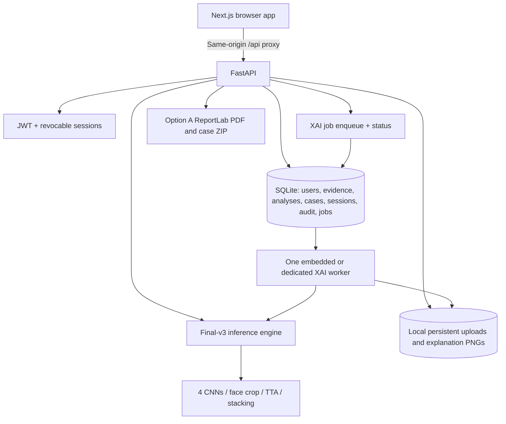

# NeuralEdge AI | Backend

**FastAPI inference, authentication, evidence management, asynchronous explainability and forensic reporting**  
**Repository release:** `v2.0.0` | **Deployed research bundle:** Final v3

[Repository overview](../README.md) | [Frontend documentation](../frontend/README.md)

> [!IMPORTANT]
> NeuralEdge AI is a **screening and forensic triage aid**, not a legal authenticity certificate. A **Fake** label does not prove manipulation; a **Real** label does not establish authenticity. Model scores are not guaranteed calibrated probabilities. Grad-CAM, LIME and SHAP explain model behavior, not verified tampering locations.

## Overview

This directory contains NeuralEdge AI's Python backend. The service handles investigator accounts, authenticated evidence uploads, analysis with the final-v3 four-CNN stacking model, an SQLite-backed explanation job queue, case management, downloadable PDFs/ZIPs, and account activity records.

**Important version distinction:** `v2.0.0` refers to this GitHub/repository release. The serialized inference configuration is **final v3**. FastAPI's current OpenAPI `version` field in `app/main.py` remains `0.2.0` and is not a claim that the website is still at an earlier feature stage.

### Capabilities

| Area | Current implementation |
| --- | --- |
| Authentication | Argon2 password hashing, 8-character minimum, 30-minute JWT access tokens, revocable remembered sessions |
| Account security | Profile editing, change password, list sessions, revoke other sessions or all sessions |
| Evidence | Owned evidence records, original-file SHA-256 identity, protected original and thumbnail downloads |
| Inference | Four CNNs, MTCNN face crop, original + horizontal-flip TTA, logistic stacking, 0.50 Fake threshold |
| Explainability | Grad-CAM with main analysis; optional LIME and SHAP jobs for the selected predicted category |
| Job processing | SQLite-persisted queue, status polling, duplicate suppression, failed-job retry, queued-job cancel |
| Investigations | Create/edit/close cases, attach/unlink analyses, list results and controlled deletion |
| Reporting | Authenticated Option A forensic PDF per analysis; bulk case PDF ZIP export (maximum 20 reports) |
| Analytics | Authenticated active-model metadata and version-matched final-v3 research figures |
| Guest demo | Optional unauthenticated quick screening with basic local rate/size controls; off by default |

## Architecture



For this release the service is designed around **one persistent backend instance and one explanation worker**. SQLite and local disk are not a distributed, multi-instance cloud architecture.

## Requirements

- **Python 3.12** (used in the project's development workflow)
- Windows PowerShell commands below; similar Unix commands work with the appropriate virtualenv activation
- Enough RAM for **four loaded TensorFlow models** and optional LIME/SHAP computations
- Trusted final-v3 `.keras` models, `stacking_meta_learner.joblib`, metadata and checksums (not distributed in Git)
- Optional `assets/face_landmarker.task` for MediaPipe facial-region interpretation

### Dependencies and known environment parity issue

Repository dependency files:

- `requirements.txt` - FastAPI, Uvicorn, auth, Pillow and report/PDF dependencies
- `requirements-dev.txt` - testing and development dependencies, including `pytest`
- `requirements-ml.txt` - base TensorFlow/NumPy/matplotlib dependencies
- `requirements-lock.txt` - historical environment lock; inspect rather than assuming it matches the final-v3 bundle

The exported final-v3 bundle records **TensorFlow 2.21.0**, while the current `requirements-ml.txt` specifies **2.20.0**. The serialized stacking learner was produced under **scikit-learn 1.6.1**. The project's current requirement files also do not explicitly list every imported final-v3 XAI package. For reproducible production deployment, reconcile and lock the *tested* combination; do not silently claim the environment is already frozen.

## Local installation (Windows PowerShell)

From the repository root:

```powershell
cd backend
py -3.12 -m venv .venv-v2
.\.venv-v2\Scripts\Activate.ps1
python -m pip install --upgrade pip
python -m pip install -r requirements-dev.txt -r requirements-ml.txt
python -m pip install "scikit-learn==1.6.1" joblib mtcnn lime shap mediapipe opencv-python-headless
python -m pip check
```

The additional packages cover final-v3 imports absent from the main requirements. If you already have a working `.venv-v2` with verified model loading, **keep it** rather than recreating it solely to follow the README.

### Configuration

Create a local `.env` if one does not already exist:

```powershell
Copy-Item .env.example .env
python -c "import secrets; print(secrets.token_urlsafe(48))"
```

Paste the generated secret into `JWT_SECRET`. **Never reuse the example placeholder or commit the actual secret.**

Representative **local-development** configuration (`backend/.env`):

```dotenv
JWT_SECRET=REPLACE_WITH_YOUR_OWN_RANDOM_SECRET_AT_LEAST_32_CHARACTERS
FRONTEND_ORIGINS=http://localhost:3000,http://127.0.0.1:3000
DATA_DIR=storage
MODEL_MANIFEST=artifacts_v2/deployment_bundle/deployment_config.json
MAX_UPLOAD_BYTES=10485760
REMEMBERED_SESSION_DAYS=7
COOKIE_SECURE=false
GUEST_DETECTION_ENABLED=false
XAI_WORKER_MODE=embedded
# Optional if the model asset has been installed:
# FACE_LANDMARKER_TASK=assets/face_landmarker.task
```

| Variable | Meaning |
| --- | --- |
| `JWT_SECRET` | Strong signing secret, minimum 32 characters; required at startup |
| `FRONTEND_ORIGINS` | Trusted browser origins for CORS and cookie-authenticated origin checks |
| `MODEL_MANIFEST` | Final-v3 `deployment_config.json`, resolved relative to `backend/` |
| `DATA_DIR` | Private SQLite database plus original images and explanation assets; default `storage` |
| `MAX_UPLOAD_BYTES` | Investigator upload limit; default **10 MiB**; use `5242880` for **5 MiB** |
| `REMEMBERED_SESSION_DAYS` | HttpOnly session lifetime, default 7 days; accepted range 1-30 |
| `COOKIE_SECURE` | `false` for local HTTP; use `true` under correctly configured production HTTPS |
| `GUEST_DETECTION_ENABLED` | `false` by default; enable only with appropriate anti-abuse protections |
| `XAI_WORKER_MODE` | `embedded` (default) or `external` for an independently started worker |
| `FACE_LANDMARKER_TASK` | Optional MediaPipe task for approximate facial-region names |

**Note:** The separately implemented guest endpoint has a **hardcoded 10 MiB** limit, JPEG/PNG validation and an **8-million-pixel** cap; it does **not** inherit `MAX_UPLOAD_BYTES`. It also has a basic in-memory **three requests per client IP per hour** limit. These local checks are not sufficient for an unrestricted public cloud endpoint.

## Trusted model artifacts

Place the active model bundle under the ignored private directory:

```text
backend/artifacts_v2/deployment_bundle/
├── deployment_config.json
├── MobileNetV2.keras
├── ResNet50V2.keras
├── Xception.keras
├── EfficientNetB0.keras
├── stacking_meta_learner.joblib
├── sha256_checksums.json
├── xai_report_contract.json
├── threshold_selection_protocol.json
└── environment_versions.json
```

Weights and the joblib learner are **not** part of the GitHub repository. Retrieve the exact verified exports from trusted project storage. Loading an untrusted serialized joblib/model artifact may execute code.

### Verify the bundle

From `backend/` with the environment activated:

```powershell
python tools/verify_final_v3_artifacts.py artifacts_v2/deployment_bundle/deployment_config.json
```

For a full engine + Grad-CAM smoke test on an image you are authorized to use:

```powershell
python tools/verify_final_v3_artifacts.py artifacts_v2/deployment_bundle/deployment_config.json --smoke-image "C:\path\to\test-image.jpg"
```

`PREFLIGHT PASSED` verifies the checks performed by that command; compare live predictions with the saved research prediction ledger when numerical parity matters. It is not a scientific robustness guarantee.

## Final-v3 model contract

1. Decode source evidence and use **RGB** pixels.
2. Run **MTCNN** face localization; select the largest valid face.
3. Extract a **square crop with a 25% margin per side**; if no suitable face is found, fall back to a center crop.
4. Resize to **224 x 224** using the specified OpenCV interpolation rules; pass pixels in **[0, 255]** without adding an external evaluation equalizer.
5. Each of **MobileNetV2**, **ResNet50V2**, **Xception**, **EfficientNetB0** scores the crop and horizontally flipped crop.
6. Average original/flip **Fake-category scores** per model; feed the four values, in their saved order, to the logistic-regression stacking learner.
7. Classify as **Fake** at the operating cutoff **0.50** and **Real** below it.

The backend records analysis ID, evidence ID, evidence SHA-256, model/version, threshold and timestamps. Model percentages are **screening scores**, not calibrated forensic probabilities.

### Held-out research metrics

Source: **matching final-v3 `deployment_config.json`**, not historical three-model reports or the website's user uploads.

| Metric | Stacking + TTA at threshold 0.50 |
| --- | ---: |
| Held-out test images | **155** (79 Real / 76 Fake) |
| Accuracy | **91.61%** |
| Balanced accuracy | **91.62%** |
| Fake precision | **90.91%** |
| Fake recall | **92.11%** |
| Fake F1 | **91.50%** |
| ROC-AUC | **0.9745** |
| Confusion matrix | TN **72**, FP **7**, FN **6**, TP **70** |

Generalization to unseen people, image sources and generators is **not established** by these figures. The original study identified possible dataset shortcuts and perturbation sensitivity; see the [root README](../README.md).

## Start the API

```powershell
python -m uvicorn app.main:create_app --factory --reload --host 127.0.0.1 --port 8000
```

- **Health:** http://127.0.0.1:8000/api/health
- **Interactive OpenAPI documentation:** http://127.0.0.1:8000/docs

A healthy HTTP response is not enough for inference: `GET /api/health` must include `inference_ready: true`. If it is `false`, inspect `inference_reason` and verify dependencies/artifacts.

To start the frontend, see [frontend/README.md](../frontend/README.md). Next.js forwards browser `/api/...` calls to this server through a same-origin rewrite.

## Authentication and evidence protection

- **Passwords:** Argon2 via `pwdlib`, minimum **8 characters** (maximum 128) for registration and new passwords. Password hashes are stored; passwords are never stored in plaintext.
- **Access:** 30-minute JWTs include a server-side session ID; protected APIs check session validity and resource ownership.
- **Remembered login:** a random session credential is stored in a **HttpOnly, SameSite=Lax** cookie scoped to `/api/auth`; the database stores its hash, not the raw cookie value. Default lifetime is 7 days.
- **Logout and security settings:** logout and session-revoke actions remove server-side sessions; changing a password revokes all sessions. An expired or revoked session cannot continue using its access JWT.
- **Evidence:** original bytes are retained under a private UUID filename; SHA-256 is checked before inference, original download, and PDF generation where applicable.
- **Authorization:** evidence, images, analyses, jobs, cases and reports are tied to the owning investigator. Do not replace this with public static file hosting.
- **Audit:** the backend records selected account, evidence, analysis, explanation and report actions. Audit logs and filesystem storage are not yet a tamper-proof legal chain of custody.

## API reference

All routes below are under `/api`. **Public** endpoints are explicitly marked. All other resources require a valid investigator Bearer token unless they are session-cookie operations.

| Domain | Methods and routes | Purpose |
| --- | --- | --- |
| Health | `GET /api/health` (**public**) | Service and model readiness |
| Registration / login | `POST /api/auth/register`, `POST /api/auth/login` (**public**) | Create account / sign in |
| Remembered session | `POST /api/auth/refresh`, `POST /api/auth/logout` | Renew access or invalidate cookie-backed session |
| Profile | `GET /api/auth/me`, `PATCH /api/auth/profile`, `POST /api/auth/password` | View/update name, change password |
| Session controls | `GET /api/auth/sessions`, `POST /api/auth/sessions/revoke-others`, `POST /api/auth/sessions/revoke-all` | View/revoke device sessions |
| Model data | `GET /api/model-info`, `GET /api/model-research` | Active runtime metadata / matching research metrics |
| Evidence | `POST /api/evidence`, `GET /api/evidence`, `GET /api/evidence/{id}` | Upload/list/inspect evidence |
| Evidence images | `GET /api/evidence/{id}/image`, `GET /api/evidence/{id}/thumbnail` | Protected original / thumbnail |
| Screening | `POST /api/analyze`, `GET /api/analyses`, `GET /api/analyses/{id}` | Run and retrieve saved screening |
| XAI jobs | `POST /api/analyses/{id}/explain/{method}` | Enqueue `lime` or `shap`, return **202** immediately |
| Job status / cancel | `GET /api/analyses/{id}/explain/{method}/status`, `DELETE /api/analyses/{id}/explain/{method}/job` | Poll status; cancel queued job |
| Explainability assets | `GET /api/analyses/{id}/{asset}` | Protected PNG (`heatmap`, `overlay`, `lime`, `shap`) |
| Case management | `GET/POST /api/cases`, `GET/PATCH/DELETE /api/cases/{id}`, linked-analysis routes | Case CRUD and linking |
| Saved PDF | `GET /api/report/{analysis_id}` | Authenticated forensic report |
| Case archive | `GET /api/cases/{case_id}/reports.zip` | Up to 20 PDFs in one ZIP |
| Guest demo | `POST /api/quick-detect` (**public when enabled**) | Unsaved JPG/PNG classification |

See `/docs` for request bodies, response schemas, exact case routes and current error codes.

### Example authenticated workflow

1. `POST /api/auth/register` with `name`, `email`, and password of at least 8 characters.
2. `POST /api/auth/login`; use the returned access token as `Authorization: Bearer <token>` for authenticated endpoints.
3. `POST /api/evidence` with `multipart/form-data` field `file` containing a JPG/PNG.
4. `POST /api/analyze` with `{"evidence_id":"<returned-evidence-uuid>"}`.
5. Read the returned analysis ID, prediction, model score, 0.50 threshold and saved Grad-CAM assets.
6. Optionally enqueue `/api/analyses/{id}/explain/lime` or `/shap`; poll its `/status` endpoint.
7. After the optional explanation is saved, download `/api/report/{id}` or attach the analysis to a case and export its ZIP.

These endpoints are intentionally split between **evidence upload** and **inference**, preserving an evidence record if the model is temporarily unavailable. Authenticated evidence storage can accept more formats than inference: **new analyses currently require JPEG or PNG**.

## Asynchronous LIME/SHAP jobs

The HTTP API does **not** block for the entire LIME or SHAP computation. The workflow is:

```text
POST explanation request -> 202 + persisted SQLite job
                            |
                            v
                     queued -> running
                                  |
                         save & integrity-check
                                  |
                         completed or failed
                            |
                            v
GET /status polling -> UI displays final explanation
```

- The UI polls approximately every **3 seconds**; requests are short-lived.
- For an analysis/method combination, duplicate clicks reuse the existing queued/running or completed job rather than computing duplicate explanations.
- Status, progress and failure messages survive a browser refresh.
- **Queued** jobs may be cancelled; **running** jobs cannot safely be interrupted by the current UI.
- Worker restarts mark interrupted jobs as failed so they can be explicitly retried; queued jobs remain stored.
- The worker rechecks the owning analysis, **evidence SHA-256**, saved model version and required assets before writing an explanation.
- The queue limits outstanding work and serializes expensive generation through a single worker.

### Default: embedded worker

With `XAI_WORKER_MODE=embedded` (default), the FastAPI process starts one XAI worker thread. This is suitable for local testing and a **single persistent host**. Avoid multiple Uvicorn workers against this single SQLite queue.

### Optional: dedicated worker on one persistent host

In `backend/.env`, set:

```dotenv
XAI_WORKER_MODE=external
```

Start the API normally in one terminal and the **single** worker in a second backend terminal:

```powershell
python -m app.xai_worker_cli
```

Both processes must use the **same durable** `DATA_DIR` and trusted model bundle. **Do not** launch an embedded and external worker together or run multiple standalone workers on this SQLite queue. A distributed deployment requires a proper shared job system with leases and persistent object/file storage.

## Grad-CAM, LIME, SHAP and report integrity

| Method | Implementation / limitations |
| --- | --- |
| Grad-CAM | Four CNN, class-specific original-view maps averaged; **not** a direct gradient of the TTA stacking output |
| LIME | Local, signed segment attribution approximating the final TTA stacking output for the selected Real or Fake category |
| SHAP | Signed attribution of the selected stacking class compared with a blurred image reference |
| MediaPipe regions | Optional approximate region naming on the face crop; **not** proof that hair, mouth, eyes or other regions were edited |

**Research-to-website SHAP difference:** the final-v3 research XAI contract specifies **`blur(32,32)`**, but the current website service uses **`blur(16,16)`**. Do not present saved website SHAP overlays as numerically identical to the notebook examples until this has been reconciled and verified.

Reports use the existing **Option A Forensic Dossier** ReportLab implementation and the branded logo asset at `assets/neuraledge_report_logo.png`. The report generator includes Grad-CAM and adds LIME/SHAP **only when those methods have actually been saved**. Downloading a PDF from a saved analysis does **not** require new inference. Case ZIPs generate individual integrity-checked PDFs and support a maximum of **20** reports plus output-size limits.

## Private data and repository safety

Do **not** commit or distribute any of these paths:

```text
backend/.env
backend/.venv-v2/
backend/.venv/
backend/artifacts/
backend/artifacts_v2/
backend/storage/
backend/assets/face_landmarker.task
*.keras
*.joblib
*.db
*.sqlite3
```

`backend/assets/neuraledge_report_logo.png` **is a public branding asset** and may be committed. Make sure your `.gitignore` rules allow that file while excluding any private model task.

Back up `storage/app.db`, `storage/uploads/` and `storage/analyses/` **together**. A database backup without its corresponding evidence/explanations cannot fully restore investigations; a filesystem backup without the database loses ownership and metadata relationships.

## Tests and verification

From `backend/`, with dependencies installed:

```powershell
python -m pytest tests -q
```

Useful focused checks:

```powershell
python -m pytest tests/test_account_research_ui_v3.py -q
python -m pytest tests/test_xai_jobs_async.py -q
python -m pytest tests/test_management_v3.py tests/test_report_readiness.py -q
```

Then perform a real-image verification using the trusted model bundle (see above), and confirm through the website that authentication, session restoration, evidence uploads, case ownership, PDF export, and LIME/SHAP job polling work correctly.

Prior patch-level tests used synthetic fixtures and an inspection-only password hashing workaround because `pwdlib` was unavailable in that inspection environment. **Do not treat those results as a substitute for testing the exact release commit with your actual `.venv-v2` and trained artifacts.**

## Production and cloud deployment limits

The current code is a **local/single-host deployment baseline**, not a full audited production deployment.

- **Host persistence:** SQLite, uploads, analysis PNGs and model artifacts must survive restarts/redeployments.
- **Memory/compute:** four CNNs plus MTCNN and XAI can consume significant RAM and CPU; measure this on the chosen host.
- **Process topology:** one API and one worker against shared local storage; do not autoscale copies with independent SQLite databases.
- **HTTPS:** enable `COOKIE_SECURE=true`, configure trusted origins and place the API behind a properly configured HTTPS reverse proxy.
- **Abuse controls:** guest rate limiting is in-memory and not distributed; add edge/body-size controls, durable quotas and authorization policies before exposing costly inference publicly.
- **Privacy:** formal retention/deletion policies, encryption-at-rest arrangements and operational backups are deployment responsibilities; do not claim they are already implemented from the presence of SHA-256 hashes.
- **Scientific scope:** final-v3 metrics are research-held-out results. Preserve warnings about source/format shortcuts, test-split size, subject overlap, unseen generators and uncalibrated scores.

## Troubleshooting

| Symptom | Check |
| --- | --- |
| Startup complains about JWT secret | Set a generated `JWT_SECRET` of at least 32 characters in `backend/.env`. |
| API healthy but `inference_ready=false` | Verify `MODEL_MANIFEST`, `.keras` weights, stacking learner, environment versions and backend logs. |
| Model artifact preflight fails | Recheck exact trusted bundle contents and SHA-256 checksum ledger. |
| `HTTP 401` after refresh | Verify remembered session, cookie settings, trusted origin, session expiry/revocation and frontend proxy. |
| Upload returns `413` | Check `MAX_UPLOAD_BYTES` (investigator) versus separate guest limit (10 MiB). |
| Analysis returns `415` | Use JPEG or PNG for inference. |
| Explanation remains queued | Ensure **exactly one** embedded or dedicated XAI worker is running and the model is ready. |
| Explanation fails after restart | Interrupted running jobs are marked failed; inspect backend logs and retry from the UI. |
| PDF/image returns `409` or `410` | Examine missing files, SHA-256 mismatch and evidence/asset integrity. Do not bypass verification. |
| Hosting disappears after redeploy | Ensure all state and assets are on **persistent** storage. |

## Release checklist

- [ ] Confirm `backend/.env` uses a non-default strong secret and is **not tracked** by Git.
- [ ] Run the entire backend test suite and the final-v3 real-image smoke test.
- [ ] Test one full analysis with Grad-CAM, LIME, SHAP and a freshly generated PDF.
- [ ] Confirm all research metrics displayed come from the **active** final-v3 manifest.
- [ ] Check the password boundary (7 characters rejected, 8 accepted), session revocation and cross-account ownership.
- [ ] Validate ZIP exports, original/thumbnail access, case deletion guards and queued-job recovery.
- [ ] Audit staged files before publishing `v2.0.0`.

## Credits

**Researched & Developed by Masum Al Mahamud & Shinthiya Islam Ayshi**  
NeuralEdge AI - Final Year Design Project

For the full project architecture, metrics, methods and known limitations, see the [repository README](../README.md).
