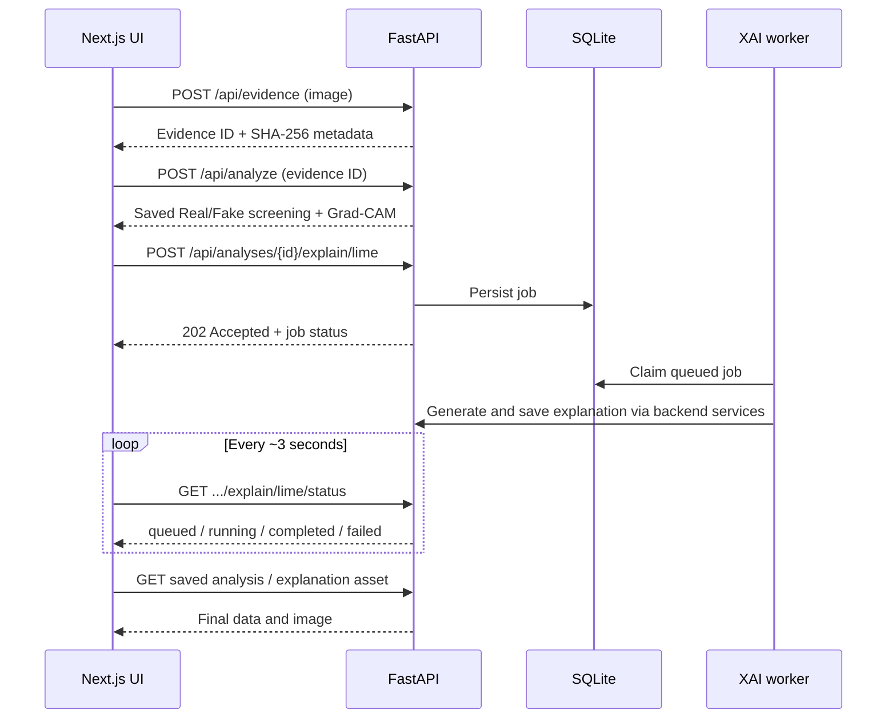

# NeuralEdge AI | Frontend

**Next.js investigator workspace and public website**  
**Repository release:** `v2.0.0` | **Model bundle:** Final v3

[Repository overview](../README.md) | [Backend documentation](../backend/README.md)

> [!IMPORTANT]
> NeuralEdge AI provides **AI-assisted deepfake image screening**, not proof that an image is authentic or manipulated. A model score is not a verified forensic probability. Grad-CAM, LIME, and SHAP illustrate model behavior; their colored regions are not confirmed edits.

## Overview

This directory contains the browser-facing application for **NeuralEdge AI**, a Final Year Design Project researched and developed by **Masum Al Mahamud & Shinthiya Islam Ayshi**. It includes a public landing page, an optional guest demonstration, and a protected investigation workspace.

Version `v2.0.0` is the **Git repository release**. The frontend's `package.json` still declares `0.1.0`; these are separate version fields.

### Features

| Area | Implemented user experience |
| --- | --- |
| Public landing page | Branded, responsive landing page; technical overview; researcher credits; full-width sticky header that compacts on scroll |
| Guest screening | Drag-and-drop or browse for JPG/PNG, image preview and removal, quick Real/Fake screening (when enabled by backend) |
| Investigator accounts | Registration, login, remembered sessions across refreshes/tabs, profile settings, password changes, session revocation and logout |
| Dashboard | Overview of recent saved analyses, Fake/Real counts, active cases, model readiness and shortcuts |
| Analyze | Evidence upload, saved detection results, Grad-CAM, optional asynchronous LIME/SHAP with polling, refresh recovery and case actions |
| Cases | Create/edit/close cases, link analyses, inspect saved results, view thumbnails, download single reports or case PDF ZIPs |
| Reports | Search/filter/paginate saved analyses, protected evidence thumbnails and individual PDF downloads |
| Model Analytics | Current model metadata plus final-v3 research metrics read from the active backend manifest, with limitations |
| Settings | Account profile, password, signed-in sessions, privacy notes, read-only system information |
| Branding | Shared header emblem, page favicon and consistent dark navy/cyan visual identity |

The investigator workspace deliberately uses **one sidebar** for navigation rather than duplicating Dashboard/Analyze/Cases/Reports in the top header.

## Technology

- **Next.js 16.3.8** (App Router, Turbopack development server)
- **React 19.2.8**, **TypeScript**
- **Tailwind CSS 4**, **Lucide React**
- Additional packages declared in `package.json`, including `axios`, `recharts`, `react-dropzone`, `react-hot-toast`, and `framer-motion`
- **FastAPI** backend accessed through a same-origin `/api` proxy

For authoritative dependency versions, use `package.json` and `package-lock.json`, not this narrative document.

## Requirements

- Node.js compatible with Next.js 16 (**Node.js 20.9+**; a maintained LTS version is recommended)
- npm
- A running NeuralEdge backend at `http://127.0.0.1:8000`
- The trusted final-v3 model bundle installed on the backend for real inference

> [!NOTE]
> Frontend pages can render with an unavailable inference engine, but new analyses and the guest demo require a backend reporting `inference_ready: true`.

## Local development (Windows PowerShell)

From the repository root:

```powershell
cd frontend
npm ci
npm run dev
```

Open **http://localhost:3000**. Run the backend in a **separate terminal** as documented in [backend/README.md](../backend/README.md).

For a clean build and source checks:

```powershell
npm run lint
npm run build
```

To preview the production build locally:

```powershell
npm run start
```

### Environment and API proxy

The application calls relative URLs such as `/api/auth/login` and `/api/analyses`. The server-side rewrite in `next.config.ts` forwards them to FastAPI, preserving a **same-origin browser flow** for session cookies.

Create `frontend/.env.local` **only if** your API is not at the default address:

```dotenv
BACKEND_URL=http://127.0.0.1:8000
```

The effective rewrite is:

```text
Browser  http://localhost:3000/api/... 
   ->   Next.js rewrite (server-side)
   ->   http://127.0.0.1:8000/api/...
```

Restart the Next.js server after editing `next.config.ts` or `.env.local`. `BACKEND_URL` is a **server-side** variable. Do not put JWT secrets, database credentials, or model paths in `NEXT_PUBLIC_*` variables.

> [!TIP]
> A previous local connection fix added `experimental.proxyTimeout: 300_000` in `next.config.ts`. The asynchronous LIME/SHAP API now uses short requests and polling. This older timeout setting is not required **for those XAI jobs**; review other long-running endpoints before removing it. The setting remains experimental.

## Pages and routing

| Route | Purpose | Access |
| --- | --- | --- |
| `/` | Landing page and technology overview | Public |
| `/detect` | Quick demonstration image screening | Public; backend guest flag required |
| `/login` | Investigator sign-in | Public |
| `/register` | New investigator account | Public |
| `/dashboard` | Investigation overview | Authenticated |
| `/analyze` | Upload, run prediction, inspect XAI and save cases | Authenticated |
| `/cases` | Manage investigation cases | Authenticated |
| `/reports` | Analysis history, thumbnails, PDF downloads | Authenticated |
| `/model-analytics` | Active model and matching research metrics | Authenticated |
| `/settings` | Profile, sessions, password and system details | Authenticated |

Route files are under `src/app/`; protected routes are grouped under `src/app/(protected)/`. `ProtectedRoute` handles authenticated access while the shared `Navbar` is mounted by the root layout.

## Important directories

```text
frontend/
├── next.config.ts                    # Same-origin /api reverse proxy
├── package.json                      # Development/build/lint commands
├── package-lock.json                 # npm dependency lockfile
├── public/
│   └── branding/                     # Full logo and compact shield mark
└── src/
    ├── app/
    │   ├── page.tsx                  # Public home
    │   ├── detect/                   # Guest image screening
    │   ├── login/ and register/      # Authentication UI
    │   └── (protected)/             # Investigator workspace
    │       ├── dashboard/
    │       ├── analyze/
    │       ├── cases/
    │       ├── reports/
    │       ├── model-analytics/
    │       └── settings/
    ├── components/
    │   ├── Navbar.tsx                # Shared full-width header / account menu
    │   ├── Sidebar.tsx               # Protected workspace navigation
    │   ├── CaseManager.tsx           # Cases, linked analyses, report downloads
    │   ├── AdditionalExplainability.tsx  # Asynchronous LIME/SHAP UX
    │   └── auth/
    │       ├── AuthProvider.tsx
    │       └── ProtectedRoute.tsx
    ├── services/
    │   └── api.ts                    # Typed API calls and access-token renewal
    └── utils/                       # Shared helpers and explanation copy
```

## Authentication and account security

Registration and password changes require **at least 8 characters** (backend-enforced, maximum 128); use longer, unique passwords in practice.

The frontend keeps the short-lived **30-minute access JWT in memory**, not local or session storage. FastAPI sets a **HttpOnly, SameSite=Lax remembered-session cookie**. After refreshing or opening a new tab, `AuthProvider` calls `/api/auth/refresh` to restore access; authenticated API calls can renew a token once on a `401` response. The configured remembered-session period defaults to **7 days**.

`BroadcastChannel` informs other open tabs about login, logout, and profile changes. The account menu provides profile/settings and sign-out. Session revocation and password changes are implemented in backend endpoints; password changes invalidate existing sessions.

**Do not** replace these safeguards with long-lived JWTs in `localStorage` or expose the session cookie value to JavaScript.

## Detection and explainability flow



LIME/SHAP are **optional** and can use substantial CPU/RAM. The site polls persisted job status instead of keeping a long HTTP connection open. Refreshing the page does not create a new job; duplicate job requests for the same analysis/method are deduplicated by the backend. A **queued** job can be cancelled; a running computation cannot safely be interrupted from the UI. Report generation includes only explanations actually saved for that analysis.

### Saved reports and evidence previews

- Evidence thumbnails and full-size images are retrieved through **authenticated endpoints**, not public static URLs.
- Per-analysis PDFs use the **Option A Forensic Dossier** layout; user-facing actions say **Download PDF**.
- A case can export a ZIP containing **up to 20** individual PDF reports, subject to server size checks.
- Generated PDF reports identify the model result as screening, not a legal authenticity certification.

## Troubleshooting

| Symptom | Check |
| --- | --- |
| Login fails or immediately redirects | Confirm FastAPI is running, `BACKEND_URL` is correct, your browser uses `localhost:3000`, and `backend/.env` has a valid `JWT_SECRET`. |
| Logged-in session does not restore | Check the `/api/auth/refresh` response in browser DevTools; confirm cookie/HTTPS settings and `FRONTEND_ORIGINS`. |
| `502` or proxy connection error | Check backend health at `http://127.0.0.1:8000/api/health`; restart Next.js after changing `BACKEND_URL`. |
| Detection unavailable | `/api/health` must report `inference_ready: true`; install verified model artifacts on the backend. |
| Guest upload rejected | Guest API must be explicitly enabled; it only accepts JPG/PNG up to **10 MiB** and has additional limits. |
| LIME/SHAP still processing | Check the explanation job-status endpoint instead of repeatedly resubmitting; long jobs may take minutes. |
| No thumbnails or PDFs | Ensure the API is reachable and the signed-in user owns the analysis/evidence. |
| `npm run build` fails | Run `npm ci` and inspect the actual Next.js/TypeScript error before changing source. |

## Production considerations

- Deploy the frontend with HTTPS and point **server-side** `BACKEND_URL` at an authenticated reachable backend.
- Protect the backend and use appropriate edge limits; guest inference is particularly resource-intensive.
- Keep credentials, model artifacts, stored evidence, and forensic reports out of browser bundles and version control.
- Use the backend's persistent storage and worker deployment guidance. A successful Next.js build alone does **not** make the full ML application deployable.
- Run real-browser checks for session restoration, logout across tabs, analysis, LIME/SHAP polling, evidence images, reports, and mobile navigation before release.

## Release verification

From `frontend/`:

```powershell
npm ci
npm run lint
npm run build
npm run dev
```

Then check Home, Login, Dashboard, Analyze, Cases, Reports, Model Analytics, and Settings. Verify that the navbar logo and an existing analysis PDF display the new branding. **This README documents the source; it is not a claim that a production build has been executed for your final Git commit.**

## Credits

**Researched & Developed by Masum Al Mahamud & Shinthiya Islam Ayshi**  
NeuralEdge AI - Final Year Design Project

For research metrics, backend deployment setup, limitations and release-wide information, see the [root README](../README.md).
